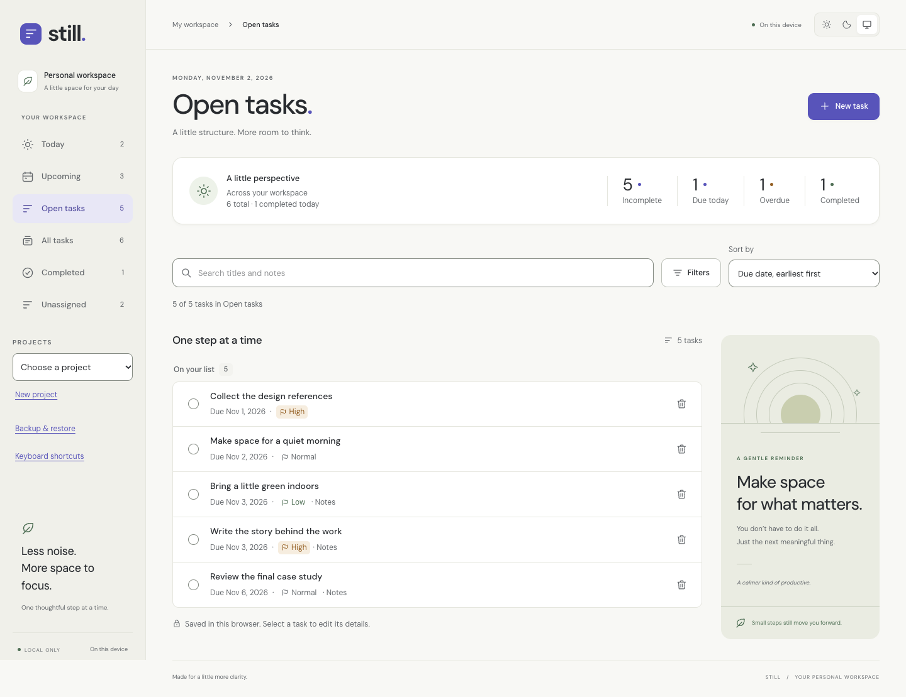
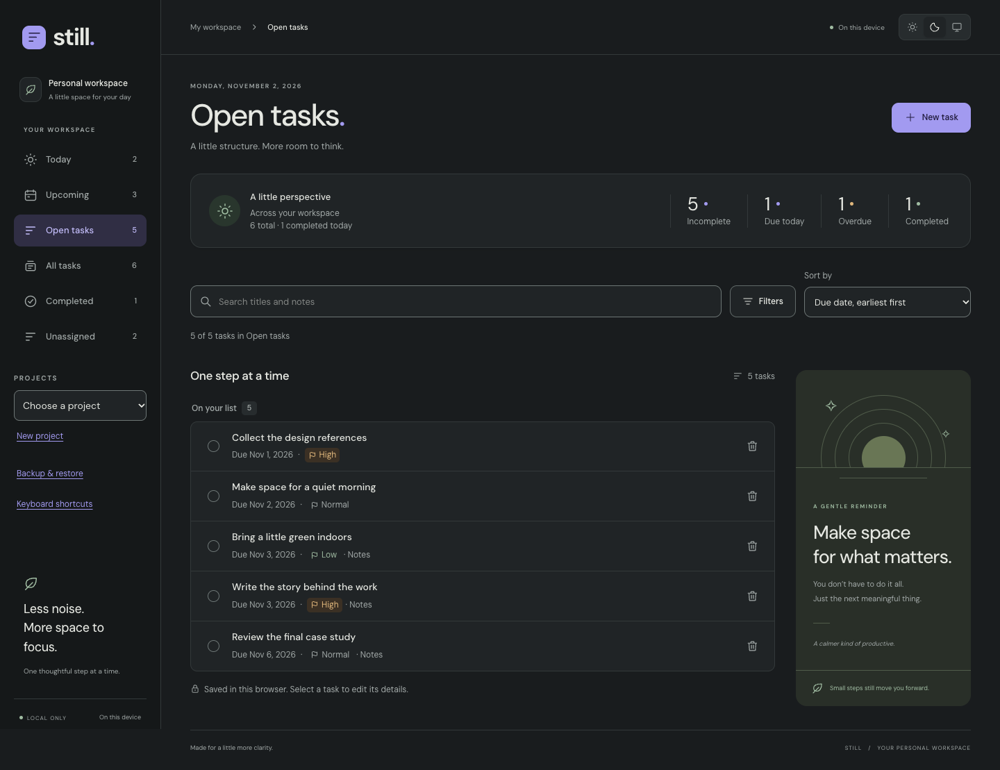

# Still — Modern Task Manager

A focused personal workspace for tasks, projects, and the days ahead. Still is built with **React, TypeScript, Vite, and Tailwind CSS** and stores your workspace locally in your browser.

Still evolved from an earlier **Java command-line Task Manager**. The repository retains its original name, `java-task-manager`, and [the exact repository URL used in my CV](https://github.com/ArmanYepiskoposyan/java-task-manager). The current application uses a modern web toolchain; Java is not required to build or run it.

**Release status:** Phase 6 final independent review approved. Source publication and website deployment are awaiting authorization. A verified live-demo link will be added after deployment; no live website is claimed here.



## What you can do

- Create, edit, complete, reopen, and delete tasks with notes, priorities, and optional due dates.
- Organize tasks into projects; rename or delete projects without deleting their tasks.
- Plan with Today (including overdue tasks), Upcoming date groups, Open tasks, Completed, and Unassigned views.
- Combine literal Unicode-aware search with status, priority, and deadline filters and five sort orders.
- Export JSON backups, preview and confirm a full replacement restore, or download unreadable stored data for recovery.
- Use light, dark, or system themes and responsive layouts down to 320px.
- Navigate with a keyboard, use optional shortcuts, and see statistics derived from your actual saved tasks.



[Mobile light](docs/screenshots/phase6/13-390-light.png) · [Mobile dark](docs/screenshots/phase6/14-390-dark.png) · [Upcoming](docs/screenshots/phase6/04-upcoming-light.png) · [Backup preview](docs/screenshots/phase6/09-import-preview.png) · [All final screenshots](docs/phase6-visual-review.md)

All screenshots use synthetic examples. The application starts empty and contains no bundled demo tasks.

## Run locally

Use Node.js **24.22.1** (recorded in `.nvmrc`) and npm **12.2.0** for the verified toolchain. The package also declares its compatible Node/npm ranges. No Java compiler, server, database, API key, or environment file is needed.

From an extracted review package, open its `TaskManager_Web` directory. After source publication is authorized, the same project can be obtained from the existing repository:

```sh
git clone git@github.com:ArmanYepiskoposyan/java-task-manager.git
cd java-task-manager
```

Then, from the project root:

```sh
nvm install
nvm use
npm ci
npm run dev
```

`nvm` is optional if the verified Node version is already installed. Open Vite’s printed local URL. The default is `http://127.0.0.1:5173`. Production preview uses a separate origin/port and therefore a separate browser workspace.

```sh
npm run build
npm run preview
```

The production output is `dist/`. `vite preview` is for local checking, not production serving. No public deployment is performed by these commands. The build uses relative asset URLs so it can be served at a domain root or beneath `/java-task-manager/`.

## Verify the project

```sh
npm run format:check
npm run check
npm exec -- playwright install chromium firefox webkit
npm run test:e2e
npm run test:release
```

On Linux, Playwright may require `npm exec -- playwright install --with-deps chromium firefox webkit`. If using a custom `PLAYWRIGHT_BROWSERS_PATH`, keep it set for installation and testing. `npm run test:e2e` starts or reuses a local production preview on port 4173; build first and ensure any reused preview serves the current output. `npm run test:release` checks the actual built files on temporary loopback servers at both root and repository-subpath URLs, including refresh persistence and JSON downloads.

| Command                    | Purpose                                                              |
| -------------------------- | -------------------------------------------------------------------- |
| `npm run typecheck`        | Strict TypeScript checking                                           |
| `npm run lint`             | ESLint with zero warnings allowed                                    |
| `npm test`                 | Unit and component tests                                             |
| `npm run test:watch`       | Unit-test watch mode                                                 |
| `npm run format:check`     | Prettier validation                                                  |
| `npm run check`            | Types, lint, unit/component tests, production build                  |
| `npm run test:e2e`         | Chromium, Firefox, and WebKit workflows and accessibility checks     |
| `npm run test:release`     | Production root/subpath smoke tests in all three engines             |
| `npm run screenshots`      | Capture final interface screenshots using synthetic data             |
| `npm run test:performance` | Synthetic task/project measurements; requires a preview on port 4173 |

The [complete Phase 6 verification report](docs/phase6-verification.md) records actual results, fresh-install checks, accessibility coverage, audit findings, and remaining limitations. The verification-only GitHub Actions workflow is prepared but has not been run on GitHub; it contains no deployment job.

## Engineering approach

```text
src/
  domain/               Task/project models, validation, commands and selectors
  lib/dates/            Local calendar boundaries and deadline formatting
  lib/persistence/      Versioned storage, backup validation and downloads
  state/                Reducer/context and write-before-publish orchestration
  app/                  Composition, themes, dates and shortcut handling
  components/           Shared accessible dialogs and workspace states
  features/tasks/       Task editor, rows, filters, groups and summary
  features/projects/    Project creation, renaming and deletion
  features/workspace/   Backup/recovery and shortcut help
tests/
  e2e/                  Cross-browser workflows, accessibility and screenshots
  fixtures/             Synthetic data and an authentic schema-1 migration fixture
  performance/          Reproducible local measurements
  release/              Static production-build verification
```

Tasks and projects are validated at runtime and stored in one schema-versioned document. A mutation writes successfully before React publishes the new state. Failed writes preserve the last committed data and the open draft. Version-1 task documents migrate in memory without a startup rewrite; later successful changes save schema 2. Corrupt or unsupported documents are protected from ordinary edits.

Imports are fully validated before a preview appears. Replacement requires an explicit acknowledgement and confirmation; it never silently merges or partially imports a file. An expected raw-storage snapshot detects intervening tab changes. See the [architecture and backup contract](docs/phase5-architecture.md) and [final technical audit](docs/phase6-release-audit.md).

## Privacy and practical limits

- Data stays in one browser profile and origin. There is no account, backend, cloud synchronization, analytics, or automatic remote backup.
- Browser data and backup files are not encrypted by the application. Clearing site data, private-mode cleanup, eviction, or device loss can remove the local copy. Keep downloaded backups somewhere safe.
- Backup/import files are limited to **10 MiB**. Browser storage quotas vary and can be smaller. Raw-document recovery downloads are available when storage can be read.
- Use one editing tab. Conflict checks detect intervening changes, but localStorage cannot guarantee atomic compare-and-swap for truly simultaneous writes.
- Completed-today counts describe currently completed records, not a lifetime activity history. Reopening or deleting a task changes those counts.
- Shortcuts (`N`, `/`, `?`) can be disabled for the session and are ignored while typing or using a dialog. View/search/filter/sort choices also reset on reload; saved data and themes persist.
- Whole-document persistence and full task-list rendering suit personal workspaces, not unlimited data volumes. Automated accessibility checks supplement, but do not replace, assistive-technology testing.

## Release and review documentation

- [Phase 6 technical audit](docs/phase6-release-audit.md)
- [Phase 6 verification and changed-file inventory](docs/phase6-verification.md)
- [Phase 6 screenshots and visual review](docs/phase6-visual-review.md)
- [Existing repository inspection and publication plan](docs/phase6-repository.md)
- [Deployment preparation and post-authorization checklist](docs/deployment.md)
- [Phase 5 architecture](docs/phase5-architecture.md), [verification](docs/phase5-verification.md), and [screenshots](docs/phase5-visual-review.md)
- [Phase 4 audit](docs/phase4-audit.md), [verification](docs/phase4-verification.md), and [screenshots](docs/phase4-visual-review.md)
- [Phase 3 architecture](docs/phase3-architecture.md), [Phase 2 architecture](docs/phase2-architecture.md), and [original design](docs/design.md)

Historical reports describe their respective approved phases. Final source publication will use only `ArmanYepiskoposyan/java-task-manager`; the repository name and CV URL will remain unchanged. Third-party notices shipped with the built application are in [public/third-party-notices.txt](public/third-party-notices.txt).

Licensed under the [MIT License](LICENSE). Copyright (c) 2026 Arman Yepiskoposyan. Third-party components retain their respective licenses; see [third-party notices](public/third-party-notices.txt). Historical phase reports record their preparation-time licensing status.
