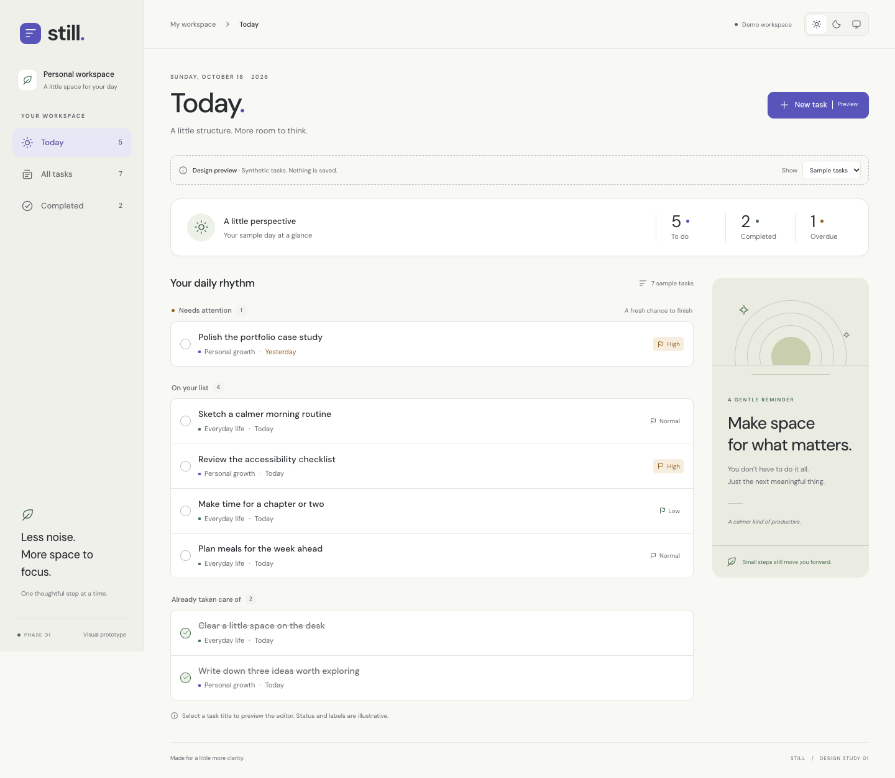
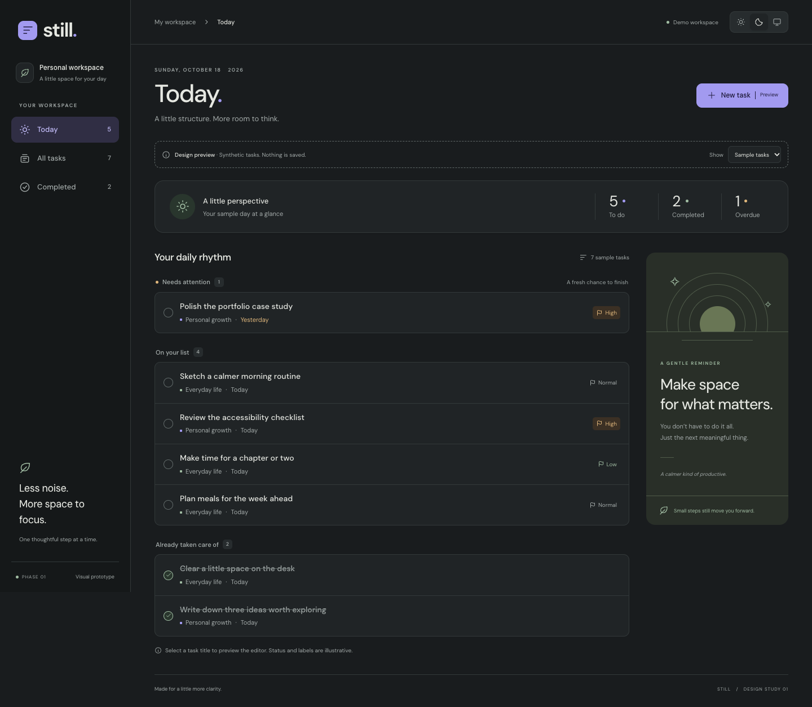
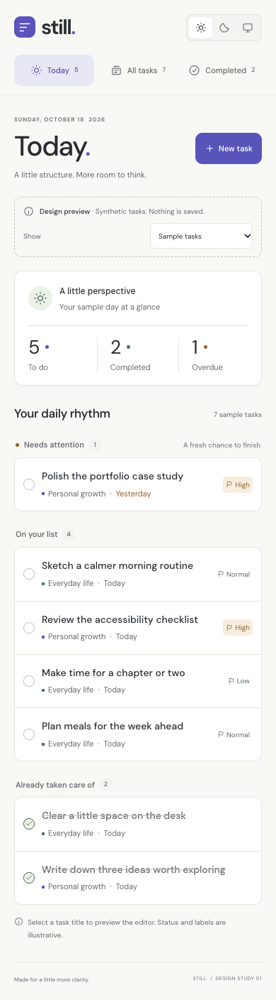
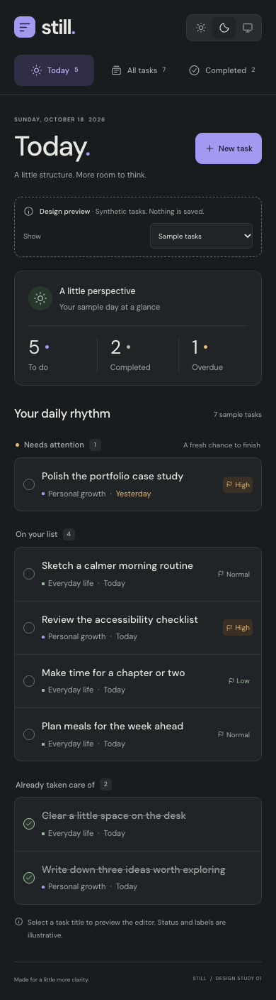
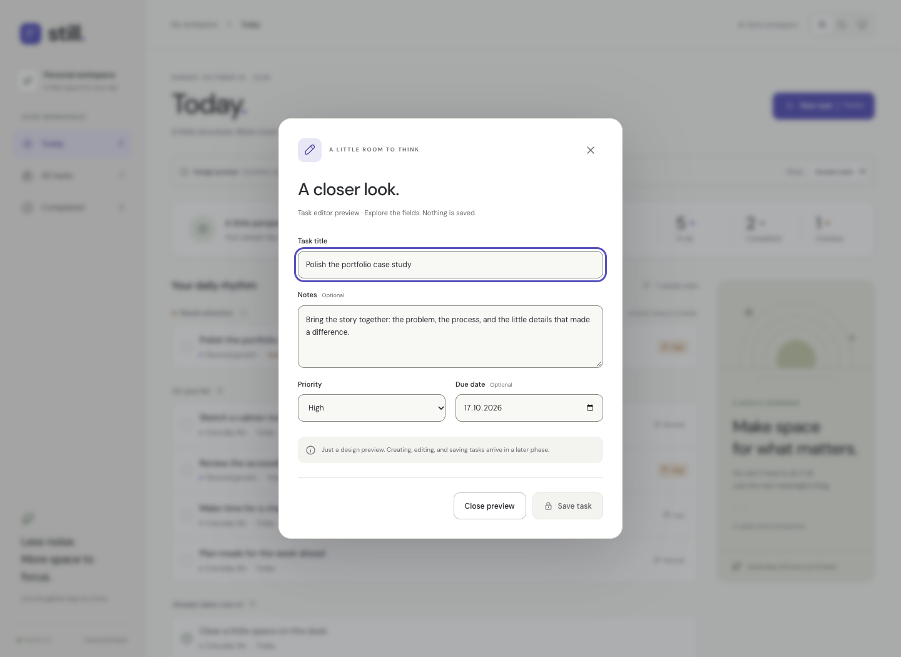
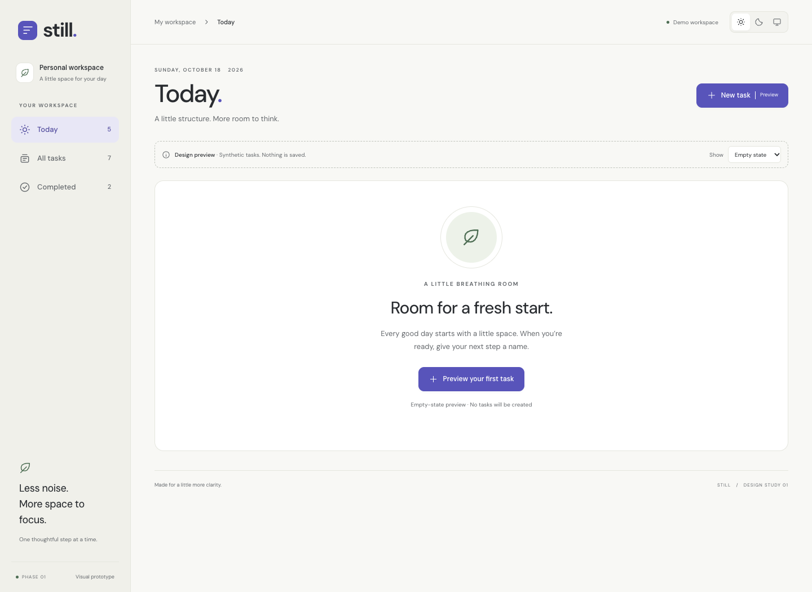
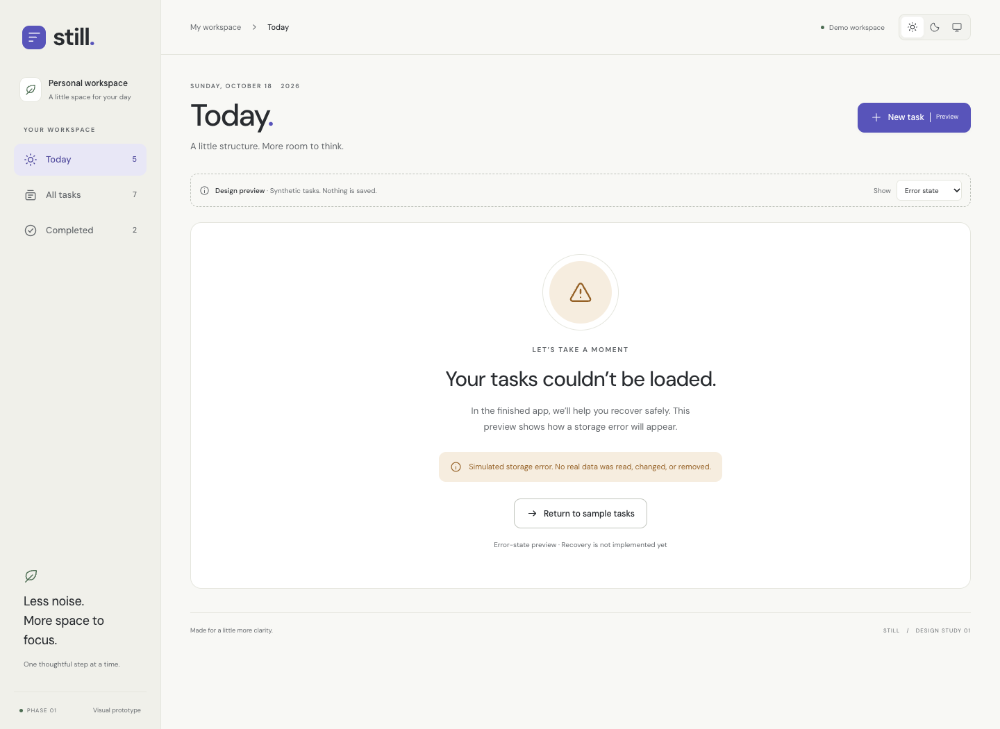
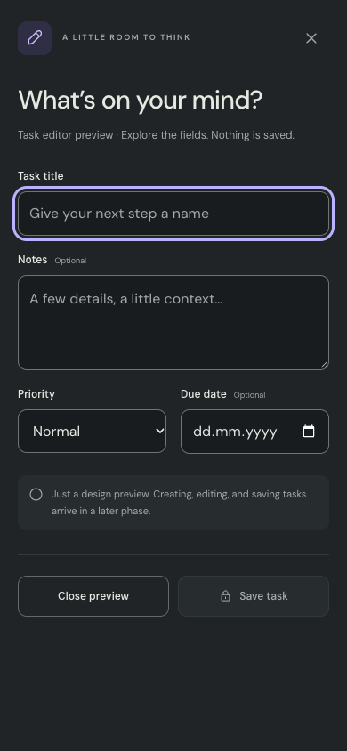
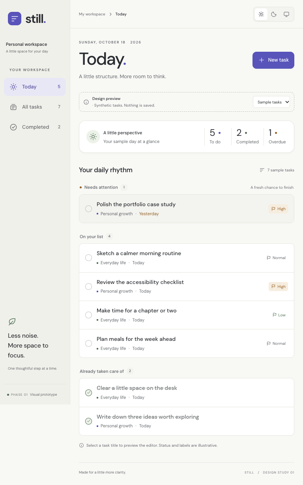
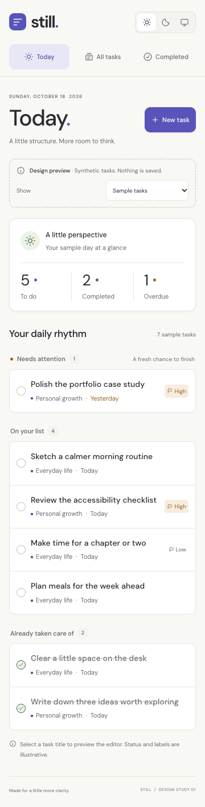

# Phase 1 screenshot evidence

Historical Phase 1 evidence, preserved for comparison. See [Phase 2 visual review](phase2-visual-review.md) for the functioning application screenshots.

These PNGs are actual browser screenshots captured by Playwright from the locally served production build. They are not generated mockups. The capture procedure is in `tests/e2e/evidence.spec.ts`; run `npm run build` followed by `npm run screenshots` with the documented browser path configured.

Desktop captures start at a 1440 × 1050 viewport. Mobile captures start at 390 × 844; dashboard/state image heights can exceed the viewport. Editor screenshots capture the viewport so the native modal backdrop is shown accurately. The tablet uses 768 × 1024 and the small phone uses 360 × 800.

## Desktop — light

## Desktop — dark

## Mobile — light

## Mobile — dark

## Task editor

## Empty state

## Error state

## Additional responsive evidence

## Review focus

Please assess visual hierarchy, comfortable text sizes, task-row density, light/dark coherence, phone navigation, modal usability, and the clarity of prototype-only controls. These are review candidates, not already approved visual baselines.
